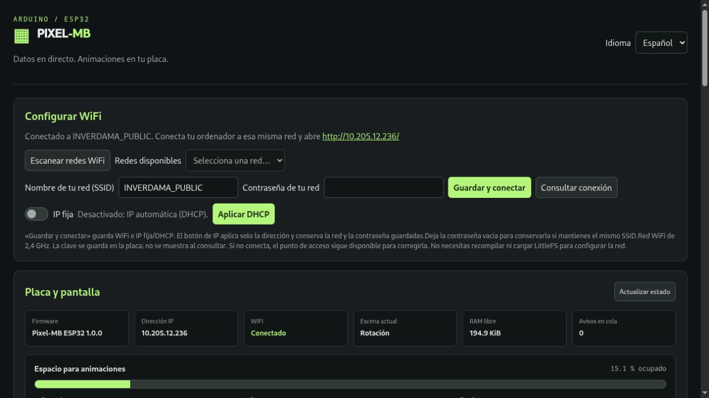

# Pixel-MB · ESP32

Pantalla autónoma de píxeles para **ESP32 DevKit / ESP32-WROOM de 4 MB** y matriz **WS2812B de 32×8**. Firmware Arduino, compilable con PlatformIO, con editor web, API HTTP, animaciones locales, WiFi e IP fija/DHCP, y actualizaciones OTA. No necesita un servidor externo.


*Aspecto del reloj en la matriz; el diseño visual se comparte con [Pixel-MB ESP8266](https://github.com/diegomardev/pixel-mb-8266). Este proyecto utiliza pines y firmware propios para ESP32.*

## Cableado


| Conexión | GPIO del ESP32 |
| --- | --- |
| DIN de la matriz WS2812B | **32** |
| BMP280/BME280 SDA (opcional) | **21** |
| BMP280/BME280 SCL (opcional) | **22** |
| BMP280/BME280 alimentación | **3V3 y GND** |
| Matriz alimentación | **5 V externos y GND común** |

Los números son GPIO, no posiciones del conector. Alimenta la matriz con una fuente de 5 V adecuada, compartiendo GND con el ESP32. No alimentes los LED desde 3V3. Si la entrada DIN requiere nivel de 5 V, utiliza un adaptador de nivel como 74AHCT125. Configura otra disposición en [`include/Config.h`](include/Config.h). La matriz usa GRB y columnas en zigzag.

## Funciones

- Editor web en español e inglés, servido directamente en `http://IP_DEL_ESP/`.
- Portal WiFi con escaneo de redes de 2,4 GHz, DHCP e IP fija con máscara, puerta de enlace y DNS.
- Hotspot de recuperación tras 15 segundos sin WiFi; reintentos cada 30 segundos.
- Animaciones JSON editables, miniaturas animadas, almacenamiento local y barra de memoria.
- Hasta 48 animaciones y 120 fotogramas por archivo; reproducción sin cargar la secuencia completa en RAM.
- Rotación ordenable con duración y color por pantalla: hora, sensor, texto, iconos y animación aleatoria.
- Segundos y siete indicadores de lunes a domingo en la hora.
- Casillas de selección aleatoria guardadas automáticamente al pulsar.
- Notificaciones temporales y variables por API compatibles con los mensajes de Pixel-MB ESP8266.
- Detección automática de BMP280 o BME280 en 0x76/0x77. BME280 añade humedad.
- Logo de inicio Pixel-MB e IP en pantalla durante 4 segundos al conectar.
- OTA de firmware autenticada que conserva animaciones y configuración.

## Compilar y cargar por USB

Abre esta carpeta en PlatformIO y ejecuta:

```sh
pio run -e esp32dev
pio run -e esp32dev -t upload
pio device monitor -b 115200
```

La primera carga instala bootloader, tabla de particiones y firmware. **Usa el firmware ESP32 de este repositorio; los binarios de ESP8266 no son compatibles.** El editor y los ejemplos se incorporan al compilar. Una partición de animaciones completamente vacía se formatea automáticamente en la primera instalación; una partición con datos no se formatea automáticamente si falla el montaje.

`partitions.csv` reserva dos espacios de 1408 KiB para firmware OTA y 1216 KiB para LittleFS. La red se guarda por separado en NVS mediante EEPROM. No cambies las particiones en un dispositivo con datos que quieras conservar.

La compilación genera credenciales OTA privadas en `ota.local.json` e `include/LocalOtaConfig.h`. No subas esos archivos ni binarios personales a GitHub. Cada clon genera sus propias credenciales.

## Primer arranque: WiFi

| Acceso inicial | Valor |
| --- | --- |
| Red hotspot del ESP32 | `PIXEL-MB-xxxxxx` |
| Contraseña | **`pixel-mb-local`** |
| Portal | **http://192.168.4.1/** |

1. Conéctate al hotspot y abre el portal.
2. Escanea las redes y elige tu SSID. Introduce su contraseña.
3. Si quieres IP fija, activa el interruptor y rellena IP, puerta de enlace, máscara y DNS.
4. Pulsa **Guardar y conectar**: guarda WiFi e IP fija/DHCP juntos.
5. La pantalla muestra la IP al conectar. Abre `http://IP_DEL_ESP/`. En redes con mDNS también puedes usar `http://pixel-mb-xxxxxx.local/`; el sufijo es el mismo identificador derivado de la MAC que aparece en el hotspot (por ejemplo, `pixel-mb-32a7b0.local`). Así cada placa tiene un nombre diferente.

El botón **Aplicar IP fija / Aplicar DHCP** cambia solo el direccionamiento y conserva la red y su contraseña. Para cambiar la IP con el mismo SSID no hace falta reescribir la contraseña. El hotspot permanece disponible durante el cambio de red y los reintentos. La hora está configurada para España peninsular; modifica `TIMEZONE` para otra zona.



## Sensor

Conecta BMP280 o BME280 en GPIO21/22. El firmware identifica el modelo automáticamente. No son necesarios para utilizar la pantalla; las páginas de sensor no disponible se omiten.

| Variable de solo lectura | Valor |
| --- | --- |
| `{bmpTemp}` | Temperatura en °C |
| `{bmpPressure}` | Presión en hPa |
| `{bmpHumidity}` | Humedad relativa en %, solo con BME280 |

Para mostrar humedad, añade una pantalla **Texto** con `Humedad: {bmpHumidity}%`. Con BMP280 la humedad es `--`. El objeto `bmp280` de `/api/sensors` conserva su nombre por compatibilidad y añade `model` y `humidityPercent`.


## Animaciones y API

Importa JSON, dibuja en el editor y pulsa **Guardar en ESP32**. Añade los archivos a la rotación o márcalos para la selección aleatoria. La [galería de Pixel-MB](https://diegomardev.com/apps/pixel-mb) permite previsualizar y descargar animaciones. Este repositorio incluye ejemplos y efectos con atribución; no incluye el catálogo completo ni logos personales.

```sh
curl -X POST http://IP_DEL_ESP/api/v3/settings \
  -H 'Content-Type: application/json' -d '{"Brightness":30}'
curl -X POST http://IP_DEL_ESP/api/variables \
  -H 'Content-Type: application/json' -d '{"Temp":23.4,"Hum":48,"Co2":650,"TVOC":32}'
curl -X POST http://IP_DEL_ESP/api/v3/notify \
  -H 'Content-Type: application/json' -d '{"data":"CO2: {Co2}","duration":5,"color":[0,255,0],"force":true}'
```

Consulta [`API.md`](API.md), [`ANIMACIONES.md`](ANIMACIONES.md) y [`THIRD_PARTY.md`](THIRD_PARTY.md).

## Actualizaciones OTA

Después de la primera carga USB, configura `host` en tu archivo privado `ota.local.json` y ejecuta:

```sh
pio run -e esp32dev_ota -t upload
```

La carga usa HTTP Digest en `/update`, usuario `admin`. No necesita una conexión de retorno desde el ESP32 al ordenador. Conserva las credenciales generadas para siguientes actualizaciones. Más información en [`OTA.md`](OTA.md).

## Pruebas

```sh
python3 -m unittest discover -s tests -p 'test_*.py'
node tests/test_editor.js
node tests/test_i18n.js
node tests/test_network_editor.js
node tests/test_saved_previews.js
node tests/test_random_autosave.js
node tests/test_board_status.js
```

La compilación y la carga USB se verifican con ESP32-WROOM. Las pruebas de sensores incluyen simuladores; comprueba el cableado y los componentes físicos de tu montaje.

### Animaciones de la instalación inicial

El firmware incluye 42 animaciones copiadas de la colección del ESP8266. Se descomprimen en LittleFS en la primera instalación, sin cargar archivos por separado. La rotación conserva los valores propios del ESP32. Las actualizaciones no reinstalan la colección ni sobrescriben las animaciones del usuario.

### Firmware y copias desde la web

En «Firmware y copias de seguridad», abre el actualizador y carga `firmware.bin` de la plataforma correspondiente. Por defecto, el actualizador web no pide usuario ni contraseña. Mientras la protección esté desactivada, cualquier equipo con acceso a la web de la placa puede actualizarla. La actualización conserva WiFi, configuración y animaciones.

«Descargar copia de seguridad» genera un JSON con las animaciones (AWX en base64 y CRC32), la rotación, las variables, el brillo y la escena base. No contiene WiFi, contraseñas ni una imagen del firmware. Puede restaurarse en ESP8266 o ESP32: reemplaza ajustes y animaciones con el mismo nombre y conserva otras animaciones. No es una restauración atómica: si se interrumpe, se informa del error y puede reintentarse. El navegador valida la copia antes de escribir y verifica cada animación enviada.

`POST /api/variables?replace=true` sustituye las variables de usuario en lugar de combinarlas con las existentes; conserva la validación habitual.

El actualizador HTTP `/update` permite cargar el `.bin` sin usuario ni contraseña. La contraseña del archivo privado `ota.local.json` se conserva únicamente para la OTA clásica de Arduino, no para el actualizador web.

### Protección web opcional

En «Acceso a la web» puedes activar un usuario y una contraseña para toda la interfaz, API y actualizador. **Deshabilitada por defecto**: mientras esté apagada puedes cargar el `.bin` directamente. Se usa autenticación HTTP Digest y los ajustes se guardan en la placa. La contraseña no se devuelve por API ni se incluye en las copias. Si la olvidas, debes borrar la configuración por USB. `GET/POST /api/web-access` consulta o cambia `enabled`, `username` y `password`; dejar la contraseña vacía conserva la anterior. Una vez activada, las llamadas API también requieren autenticación Digest. La OTA clásica conserva su clave independiente.

Si activas la protección web y quieres usar el cargador HTTP de PlatformIO, añade `webUsername` y `webPassword` al archivo privado `ota.local.json`. Sin protección web no hacen falta estos campos.
